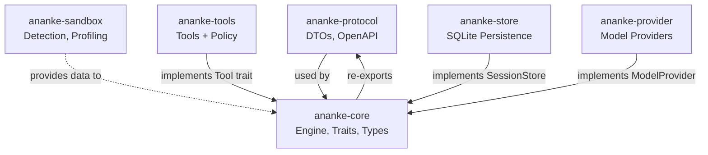

# Ananke - Consolidated Architecture Documentation

**Generated**: 2026-11-16  
**Source**: All crates in `crates/`

---

## Table of Contents

1. [Overview](#overview)
2. [Crate Dependency Graph](#crate-dependency-graph)
3. [Crate: ananke-core](#crate-ananke-core)
4. [Crate: ananke-protocol](#crate-ananke-protocol)
5. [Crate: ananke-sandbox](#crate-ananke-sandbox)
6. [Crate: ananke-tools](#crate-ananke-tools)
7. [Crate: ananke-store](#crate-ananke-store)
8. [Crate: ananke-provider](#crate-ananke-provider)
9. [Cross-Cutting Patterns](#cross-cutting-patterns)
10. [Data Flow Summary](#data-flow-summary)

---

## Overview

Ananke is a multi-crate Rust project implementing an AI agent runtime with:
- **Core agent loop** (`ananke-core`)
- **Protocol DTOs & OpenAPI** (`ananke-protocol`)
- **Sandbox detection & device profiling** (`ananke-sandbox`)
- **Built-in tools with policy enforcement** (`ananke-tools`)
- **SQLite persistence** (`ananke-store`)
- **Model provider abstraction** (`ananke-provider`)

All crates are in a Cargo workspace with `ananke-core` as the central dependency.

---

## Crate Dependency Graph



**Key principle**: `ananke-protocol` is the **only** external dependency clients need (AD-05).

---

## Crate: ananke-core

### Module Structure

```
crates/ananke-core/src/
├── lib.rs          # Public API re-exports
├── ids.rs          # ID types (SessionId, TurnId, PartId, MessageId, ToolCallId, PermissionId)
├── engine.rs       # Core agent loop (Engine, EngineError, MAX_TOOL_ITERATIONS=16)
├── store.rs        # Persistence abstraction (SessionStore trait, InMemoryStore)
├── approval.rs     # Permission system (PermissionMode, Approver, Decision)
├── tool.rs         # Tool system (Tool trait, ToolRegistry, ToolOutput)
├── provider.rs     # Model provider abstraction (ModelProvider, ProviderRequest, ProviderEvent)
├── event.rs        # Event system (Event, EventKind, EventSink, MemoryEventSink)
├── turn.rs         # Turn state machine (Turn, TurnStatus, Usage)
├── part.rs         # Content units (Part, PartKind)
├── session.rs      # Session container (Session)
└── message.rs      # Message wrapper (Message, Role)
```

### Key Types

| Type | Module | Description |
|------|--------|-------------|
| `SessionId` | `ids.rs` | Prefix `ses`, unique session identifier |
| `TurnId` | `ids.rs` | Prefix `trn`, unique turn identifier |
| `PartId` | `ids.rs` | Prefix `prt`, unique part identifier |
| `MessageId` | `ids.rs` | Prefix `msg`, unique message identifier |
| `ToolCallId` | `ids.rs` | Prefix `call`, correlates tool call with result |
| `PermissionId` | `ids.rs` | Prefix `perm`, unique permission request identifier |

All IDs implement: `Clone, Debug, PartialEq, Eq, Hash, Serialize, Deserialize, Display, Default, From<String>, From<&str>`

### Core Traits

| Trait | Module | Purpose |
|-------|--------|---------|
| `SessionStore` | `store.rs` | Persistence abstraction (save_turn, load_turns, set_turn_status) |
| `ModelProvider` | `provider.rs` | Stream tokens from LLM |
| `EventSink` | `event.rs` | Emit events to transport (SSE/stdio) |
| `Approver` | `approval.rs` | Decide permission requests |
| `Tool` | `tool.rs` | Executable tool with schema |

### Key Enums

| Enum | Module | Variants |
|------|--------|----------|
| `PermissionMode` | `approval.rs` | `ReadOnly`, `WorkspaceWrite`, `DangerFullAccess`, `External` |
| `Verdict` | `approval.rs` | `Allow`, `Ask`, `Deny` |
| `Decision` | `approval.rs` | `AllowOnce`, `AllowAlways`, `Deny` |
| `TurnStatus` | `turn.rs` | `Running`, `AwaitingTool`, `Completed`, `Interrupted`, `Failed { reason }` |
| `PartKind` | `part.rs` | `Text`, `Reasoning`, `ToolCall`, `ToolResult` |
| `Role` | `message.rs` | `User`, `Assistant`, `Tool` |
| `EventKind` | `event.rs` | 11 variants (turn.*, part.*, permission.*, warning) |
| `ProviderEvent` | `provider.rs` | `TextDelta`, `ReasoningDelta`, `ToolCall`, `Done`, `Failed` |

### Main Entry Points

#### Engine (engine.rs)
```rust
pub struct Engine {
    provider: Arc<dyn ModelProvider>,
    tools: Arc<ToolRegistry>,
    approver: Arc<dyn Approver>,
    events: Arc<dyn EventSink>,
    store: Arc<dyn SessionStore>,
    permission: PermissionMode,
    seq: AtomicU64,
}

impl Engine {
    pub fn new(provider, tools, approver, events, store) -> Self
    pub fn with_permission(self, PermissionMode) -> Self
    pub fn permission_mode(&self) -> PermissionMode
    
    pub async fn run_turn(&self, session: &mut Session, input: Vec<Message>) -> Result<TurnId, EngineError>
    pub async fn resume_turn(&self, session: &mut Session, turn_id: &TurnId) -> Result<(), EngineError>
}
```

#### Session (session.rs)
```rust
pub struct Session {
    pub id: SessionId,
    pub title: String,
    pub model: String,
    messages: Vec<Message>,
    turns: Vec<Turn>,
}

impl Session {
    pub fn new(model: impl Into<String>) -> Self
    pub fn with_title(self, title: impl Into<String>) -> Self
    pub fn messages(&self) -> &[Message]
    pub fn push_message(&mut self, Message)
    pub fn turns(&self) -> &[Turn]
    pub fn push_turn(&mut self, Turn)
    pub fn turn(&self, &TurnId) -> Option<&Turn>
    pub fn turn_mut(&mut self, &TurnId) -> Option<&mut Turn>
    pub fn turns_awaiting_tool(&self) -> impl Iterator<Item = &Turn>
}
```

#### ToolRegistry (tool.rs)
```rust
pub struct ToolRegistry { tools: BTreeMap<String, Arc<dyn Tool>> }

impl ToolRegistry {
    pub fn register(&mut self, Arc<dyn Tool>) -> Result<(), RegistryError>
    pub fn get(&self, &str) -> Option<Arc<dyn Tool>>
    pub fn schemas(&self) -> Vec<ToolSchema>
}
```

### Data Flow: Turn Lifecycle

```
Engine.run_turn(session, input):
  1. Push input messages → session.messages
  2. Create new Turn (status=Running)
  3. Persist turn → store.save_turn()
  4. Emit TurnStarted event
  5. Loop (max 16 iterations):
     a. model_step(): Stream from provider
        - Emit PartStarted/PartDelta/PartCompleted events
        - Collect tool_calls, text, reasoning parts
        - Persist turn parts + usage
        - Push assistant message to session.history
     b. If tool_calls empty → complete_turn()
     c. run_tools():
        - Set turn.status = AwaitingTool, persist
        - Emit TurnAwaitingTool
        - For each call:
          * Check permission via PermissionMode.verdict(tool.mutating())
          * If Ask → approver.decide() → emit PermissionRequested/Resolved
          * Execute tool → ToolOutput
          * Emit PartCompleted (ToolResult)
          * Push tool message to session.history
        - Set turn.status = Running, persist
  6. complete_turn(): status=Completed, emit TurnCompleted
     OR fail_turn(): status=Failed, emit TurnFailed
```

### Resume Flow (AD-17)

```
Engine.resume_turn():
  1. Load pending tool calls from turn.pending_tool_calls()
  2. Set turn.status = Running, persist
  3. run_tools() for pending calls
  4. drive() to continue model loop
```

### Event Emission

```
Engine.emit() → Event { seq: atomic++, session_id, at: now_millis(), kind }
EventSink.emit() async (transport: SSE, stdio, etc.)
EventKind.is_persistent() → PartDelta not persisted to event log
```

---

## Crate: ananke-protocol

### Module Structure

```
crates/ananke-protocol/src/
├── lib.rs           # Entry point, re-exports all public API
├── error.rs         # RFC 9457 ProblemDetails - single error format
├── event.rs         # Event DTO + payload for SSE streaming
├── limits.rs        # Resource limits (AD-15)
├── message.rs       # Message history DTO
├── meta.rs          # /api/meta - server capabilities
├── part.rs          # PartDto - smallest content unit
├── permission.rs    # Permission modes & decisions (AD-07)
├── session.rs       # Session lifecycle + state snapshot (AD-08)
├── turn.rs          # Turn lifecycle + input/output (AD-06, AD-17)
├── openapi.rs       # OpenAPI 3.1 document generation (utoipa)
└── bin/gen.rs       # CLI generator: `cargo run -p ananke-protocol -- gen openapi`
```

**Design principle**: Crate contains **only DTO + OpenAPI schema** (no dependency on `ananke-core`/`ananke-sandbox`)

### Key Types

| Module | Key Types |
|--------|-----------|
| `part.rs` | `PartKindDto` (Text/Reasoning/ToolCall/ToolResult), `PartDto` (tagged enum) |
| `permission.rs` | `PermissionModeDto` (kebab-case), `PermissionDecisionDto`, `PermissionScopeDto`, `PermissionDecisionRequest` |
| `session.rs` | `CreateSessionRequest`, `UpdateSessionRequest`, `SessionDto`, `SessionStateDto` |
| `turn.rs` | `TurnStatusDto`, `TurnDto`, `InputPartDto`, `CreateTurnRequest`, `SteerRequest`, `TurnAcceptedResponse`, `UsageDto` |
| `event.rs` | `EVENT_TYPES` (36 types), `EventPayloadDto` (tagged enum), `EventDto` (flattened envelope) |
| `error.rs` | `ProblemDetails` (RFC 9457), constants `PROBLEM_CONTENT_TYPE`, `CODE_LIMIT_EXCEEDED`, `CODE_TUI_NOT_ATTACHED` |
| `limits.rs` | `LimitsDto` (6 resource limits), `PatchLimitsRequest` |
| `meta.rs` | `DeviceProfileDto`, `SandboxKindDto`, `MetaResponse` |
| `message.rs` | `RoleDto`, `MessageDto` |

### Serialization Conventions

| Convention | Applies To | Examples |
|------------|------------|----------|
| **camelCase** | Struct fields, request/response body | `sessionID`, `turnID`, `parentID`, `createdAt`, `maxContextTokens` |
| **snake_case** | Enum variants (PartKindDto, RoleDto, TurnStatusDto tag, PermissionDecisionDto, PermissionScopeDto, EventPayloadDto tag) | `tool_call`, `awaiting_tool`, `allow_always`, `part.delta` |
| **kebab-case** | PermissionModeDto, SandboxKindDto, DeviceProfileDto | `read-only`, `workspace-write`, `restricted-token`, `constrained` |
| **rename** | ID suffix uppercase | `#[serde(rename = "callID")]`, `#[serde(rename = "turnID")]`, `#[serde(rename = "parentID")]` |

### Data Flow: Request/Response

```
Client                              Server
  │                                    │
  ├─ POST /api/session ───────────────►│  CreateSessionRequest
  │◄─── 201 SessionDto ────────────────┤
  │                                    │
  ├─ POST /api/session/{id}/turn ─────►│  CreateTurnRequest
  │◄─── 202 TurnAcceptedResponse ─────┤
  │                                    │
  ├─ GET /api/session/{id}/state ─────►│  SessionStateDto (resync)
  │◄─── 200 SessionStateDto ──────────┤
  │                                    │
  ├─ SSE /api/session/{id}/events ────►│  EventDto stream (seq, sessionID, at, payload)
  │◄─── EventDto (flattened) ─────────┤
```

### Event Streaming (SSE)

- Flattened envelope: `seq`, `sessionID`, `at` + payload fields at same level
- `seq` monotonically increasing per session; used for `?since=` and `Last-Event-ID`
- Client **ignores** unrecognized event types (forward-compatible)

### Permission Flow (AD-07)

```
Server: permission.requested (tool, arguments)
Client: POST /api/session/{id}/permission/{permID} { decision, scope? }
Server: permission.resolved (decision, scope?)
```

### Error Handling

1. **Single format**: RFC 9457 `ProblemDetails`
2. **Content-Type**: `application/problem+json` (not `application/json`)
3. **Extended codes** in `code` field:
   - `limit_exceeded` (AD-15)
   - `tui_not_attached` (§5.5)
4. **HTTP status** repeated in body (`status` field)
5. **Required header**: All requests need `X-Ananke-Protocol: 1`

---

## Crate: ananke-sandbox

### Module Structure

```
crates/ananke-sandbox/
├── src/
│   ├── lib.rs          # Root module, public API, core types
│   ├── detect.rs       # Platform-specific sandbox detection
│   └── profile.rs      # Device profiling by RAM (AD-15)
└── tests/
    └── report.rs       # Integration test serialization/roundtrip
```

### Key Types

#### `SandboxKind` (enum) — *src/lib.rs:24-35*
```rust
#[derive(Clone, Copy, Debug, PartialEq, Eq, Serialize, Deserialize)]
#[serde(rename_all = "kebab-case")]
pub enum SandboxKind {
    Landlock,          // Linux ≥5.13
    Seatbelt,          // macOS
    RestrictedToken,   // Windows
    None,              // Cannot enforce
}
```
- 4 fixed values for `/api/meta` (§5.1)
- `as_str()` → stable string for log/API

#### `SandboxReport` (struct) — *src/lib.rs:50-103*
```rust
pub struct SandboxReport {
    kind: SandboxKind,
    mechanisms: Vec<String>,     // ["bwrap","landlock","seccomp"]
    reason: Option<String>,      // Why none or notes
}
```
**Constructors:**
- `none(reason)` → `SandboxKind::None`
- `available(kind, mechanisms, reason)` → enforced

**Methods:**
- `kind()`, `mechanisms()`, `reason()`
- `is_enforced()` → `kind != None`
- `needs_warning()` → `!is_enforced()` (client MUST show warning)

#### `DeviceProfile` (enum) — *src/profile.rs:8-17*
```rust
#[derive(Clone, Copy, Debug, PartialEq, Eq, Serialize, Deserialize)]
#[serde(rename_all = "lowercase")]
pub enum DeviceProfile {
    Constrained,  // < 1.5 GiB
    Small,        // < 4 GiB
    Default,      // ≥ 4 GiB
}
```
- `from_mem_total(bytes)` — AD-15 thresholds
- `as_str()` → `"constrained"|"small"|"default"`

### Main Entry Points

| Function | Module | Returns | Purpose |
|----------|--------|---------|---------|
| `detect()` | `detect` / re-export `lib` | `SandboxReport` | Measure sandbox capability at startup |
| `device_profile()` | `profile` / re-export `lib` | `DeviceProfile` | Effective profile by RAM |
| `mem_total_bytes()` | `profile` / re-export `lib` | `Option<u64>` | `MemTotal` bytes (Linux/Android) |
| `SandboxKind::as_str()` | `lib` | `&'static str` | Key for `/api/meta` |
| `DeviceProfile::as_str()` | `profile` | `&'static str` | Key for config/profile |

**Only measures, never enforces** — crate does NOT impose policy on child processes (docstring lib.rs:11-13).

### Detection Mechanisms

#### Per-Platform Logic (*detect.rs*)

| Platform | Logic | Mechanisms |
|----------|-------|------------|
| **Android/Termux** | Always `none` | Permission rules only barrier |
| **Linux** | `linux::detect()` → `classify(LinuxProbe)` | See below |
| **macOS** | `Seatbelt` + `["seatbelt"]` | Hardcoded, no probe |
| **Windows** | `RestrictedToken` + `["restricted-token"]` | Hardcoded |
| **Other** | `none("unsupported platform")` | — |

#### Linux Classification (*detect.rs:79-115*)

```
1. Termux? → none
2. Kernel < 5.13? → none
3. LSM list missing landlock? → none
4. Has landlock (or unreadable LSM with kernel ≥5.13):
   mechanisms = [bwrap?, "landlock", seccomp?]
   reason = "has bwrap, prefer over direct Landlock" (if bwrap)
   → Landlock
```

**Probe sources:**
- `/proc/sys/kernel/osrelease` → kernel version
- `/sys/kernel/security/lsm` → LSM list (optional)
- `/proc/sys/kernel/seccomp/actions_avail` → seccomp
- `PATH` search `bwrap` (bubblewrap)
- Env `PREFIX` + path `/data/data/com.termux/files/usr` → Termux

#### Device Profiling (*profile.rs*)

| MemTotal (bytes) | Profile |
|------------------|---------|
| < 1.5 GiB (1.5×1024³) | Constrained |
| < 4 GiB | Small |
| ≥ 4 GiB | Default |

- Only reads `/proc/meminfo` on Linux/Android
- Cannot detect RAM → `Default` (generous, not guessing low)

### Security / Boundary Patterns

| Pattern | Implementation |
|---------|----------------|
| **Capability-based, not promise-based** | Only measures actual (`detect`), doesn't assume platform has sandbox |
| **Explicit "none" with reason** | `SandboxReport::none(reason)` always has non-empty `reason` |
| **Warning flag for clients** | `needs_warning() = !is_enforced()` — client MUST display warning |
| **No enforcement in this crate** | Docstring: "crate only measures, does not impose policy" (lib.rs:11-13) |
| **Mechanism transparency** | `mechanisms` vector reveals active mechanisms (`bwrap`, `landlock`, `seccomp`) |
| **Platform-gated code** | `#[cfg(target_os=...)]` per branch, avoid compile-time assumptions |

### Testing Patterns

#### Unit Tests (*detect.rs:170-260*, *profile.rs:74-108*)
- **Pure logic separation**: `classify()` takes `LinuxProbe` → testable on any OS build machine
- **Table-driven**: `probe()` helper + field overrides
- **Edge cases**: kernel parse, Termux, unreadable LSM, bwrap priority

#### Integration Tests (*tests/report.rs*)
- **Serialization roundtrip**: `SandboxKind` ↔ JSON `"kebab-case"`, `DeviceProfile` ↔ `"lowercase"`
- **Contract tests**:
  - `report_none_co_ly_do_va_can_canh_bao`: `none` must have `reason`, `mechanisms=[]`, `needs_warning=true`
  - `report_khong_co_reason_thi_khong_serialize_field`: `reason=None` → skip serialize
  - `detect_tra_ve_bao_cao_nhat_quan`: `detect()` returns valid report on test machine
  - `device_profile_khop_voi_mem_total_doc_duoc`: `device_profile()` matches actual `mem_total_bytes()`

---

## Crate: ananke-tools

### Module Structure

```
ananke-tools/
├── lib.rs           # Public entry: register_builtin() + re-export 6 tools + policy
├── policy.rs        # Policy system (PolicyMode, ToolPolicy, PolicyError)
├── bash.rs          # Tool `bash` – run shell commands
├── fs_read.rs       # Tool `read` – read text files by lines
├── fs_write.rs      # Tool `write` – overwrite entire file
├── fs_edit.rs       # Tool `edit` – replace exact text segments
├── search.rs        # Tool `grep` (regex) + `glob` (path pattern)
├── walk.rs          # Directory tree walker shared by grep/glob
├── util.rs          # Helpers: read JSON, truncate, display_path
└── tests/tools.rs   # Integration tests for all 6 tools + policy
```

- All tools implement `ananke_core::Tool` (async trait)
- `register_builtin()` takes `ToolRegistry` + `ToolPolicy`, registers 6 tools sharing `Arc<ToolPolicy>`
- No private modules beyond listed files

### Key Types

| Type | Location | Description |
|------|----------|-------------|
| `PolicyMode` | `policy.rs:16-24` | `ReadOnly`, `WorkspaceWrite`, `DangerFullAccess` |
| `PolicyError` | `policy.rs:36-44` | `ReadOnly`, `OutsideRoot(PathBuf)`, `Invalid(PathBuf)` |
| `ToolPolicy` | `policy.rs:51-57` | Immutable, `Arc`-shared: `mode`, `base`, `writable_roots`, `network` |
| `BashTool` | `bash.rs:24-28` | `policy: Arc<ToolPolicy>`, `timeout`, `max_output` |
| `ReadTool` | `fs_read.rs:18-20` | Contains `policy` only |
| `WriteTool` | `fs_write.rs:13-15` | Contains `policy` only |
| `EditTool` | `fs_edit.rs:19-21` | Contains `policy` only |
| `GrepTool` / `GlobTool` | `search.rs:31-33, 189-191` | Contains `policy` only |
| `GlobMatcher` | `search.rs:306-338` | Wraps `globset`, distinguishes file-name vs relative-path match |

### Public API

```rust
// lib.rs
pub fn register_builtin(registry: &mut ToolRegistry, policy: ToolPolicy) -> Result<(), RegistryError>

// Re-exports
pub use bash::BashTool;
pub use fs_edit::EditTool;
pub use fs_read::ReadTool;
pub use fs_write::WriteTool;
pub use policy::{PolicyError, PolicyMode, ToolPolicy};
pub use search::{GlobTool, GrepTool};
```

- `ToolPolicy` constructors:
  - `read_only(base)`
  - `workspace_write(base, writable_roots)`
  - `danger_full_access(base)`
- `ToolPolicy::with_network(bool)` – declarative flag, crate doesn't block sockets

### Tool Details

| Tool | `mutating()` | Required Schema | Key Limits | Special Handling |
|------|--------------|-----------------|------------|------------------|
| **bash** | `true` | `command: string` | timeout 60s (max 600s), output 64 KB | `kill_on_drop`, env `NO_COLOR=1`, `TERM=dumb` |
| **read** | `false` | `path: string` | file ≤ 2 MB, read ≤ 20k lines, output ≤ 256 KB | Auto-detect binary (null byte in first 8 KB), supports `offset`/`limit` |
| **write** | `true` | `path`, `content` | No size limit (except FS) | Auto-creates parent directories |
| **edit** | `true` | `path`, `old_string`, `new_string` | file ≤ 2 MB | `old_string` must match **exactly once** (unless `replace_all=true`) |
| **grep** | `false` | `pattern: string` | scan ≤ 20k files, each ≤ 2 MB, results ≤ 2k lines | Runs in `spawn_blocking`, skips `.git`, `node_modules`, `target`… |
| **glob** | `false` | `pattern: string` | walk ≤ 20k files, results ≤ 2k paths | `GlobMatcher`: no `/` → match filename; has `/` → match relative path |

#### BashTool
- Cross-platform: Windows `cmd /C`, Unix `sh -c`
- Timeout via `tokio::time::timeout`; child killed via `kill_on_drop(true)`

#### ReadTool
- Reads entire file into RAM (≤ 2 MB), splits lines, returns slice `offset..offset+limit`
- Output: `{rel_path}: lines {start}-{end} / {total}\n{body}`

#### WriteTool
- `tokio::fs::create_dir_all(parent)` then `tokio::fs::write(path, content)`

#### EditTool
- Reads file → `text.matches(&old_string).count()`
- 0 match / >1 match (no `replace_all`) → error asking model to re-read file
- Replace: `replace_all` ? `text.replace()` : `text.replacen(..., 1)`

#### GrepTool / GlobTool
- Shared `walk::walk_files(root, MAX_WALK_FILES=20_000)` – non-recursive DFS, skip symlinks, skip `SKIP_DIRS`
- `grep_sync`: reads file sync in `spawn_blocking`, scans line-by-line with `regex::Regex`
- `glob_sync`: filters candidates with `GlobMatcher.is_match()`

### Policy System

```rust
// policy.rs
impl ToolPolicy {
    pub fn allows_mutation(&self) -> bool { self.mode != ReadOnly }
    pub fn allows_shell(&self) -> bool { self.allows_mutation() }
    pub fn allows_network(&self) -> bool { self.network || self.mode == DangerFullAccess }

    // Read: only resolve + normalize, NO root check
    pub fn resolve_read(&self, raw: &str) -> Result<PathBuf, PolicyError>

    // Write: resolve → canonicalize_best_effort → check writable_roots (WorkspaceWrite)
    pub fn resolve_write(&self, raw: &str) -> Result<PathBuf, PolicyError>
}
```

- `canonicalize_best_effort`: resolves symlinks for existing parts, rejoins non-existing (needed for `write` new file)
- `normalize`: handles `.`/`..` lexically, returns `None` if `..` escapes root
- **Important**: Policy only enforces at API level; on Android/Termux no namespace sandbox → `/api/meta` must report `sandbox = "none"`

### Testing Patterns (`tests/tools.rs`)

- Each test creates temp workspace (`workspace(name)`), cleans up after (`cleanup`)
- Policy helper: `policy(dir) -> Arc<ToolPolicy>` = `workspace_write(dir, [dir])`
- Coverage:
  - Round-trip write → read → edit → read
  - `read` offset/limit, missing file, binary reject
  - `edit` reject on 0 match / multi-match, `replace_all` works
  - Policy `read_only` blocks write & bash
  - `workspace_write` blocks path traversal (`../escape.txt`, absolute outside)
  - `bash` success + non-zero exit code
  - `grep` regex + glob filter, case-insensitive, empty result
  - `glob` pattern `*.rs`, `src/nested/*.rs`
  - `register_builtin` registers 6 tools, duplicate name = error
  - `mutating()` flag correct for each tool

- All tests use `#[tokio::test]` except 2 sync tests

---

## Crate: ananke-store

### Module Structure

```
crates/ananke-store/
├── src/
│   ├── lib.rs          # Public API: re-export SqliteStore
│   ├── store.rs        # SqliteStore implementation + SessionStore trait
│   └── migrations.rs   # Schema migration using PRAGMA user_version
└── tests/
    └── store.rs        # Integration tests
```

### Key Types (from `ananke_core`)

| Type | Description |
|------|-------------|
| `Session` | Session (id, title, model, created_at, turns) |
| `Turn` | Turn (id, status, parts[], usage) |
| `Part` | Enum: `Text`, `Reasoning`, `ToolCall`, `ToolResult` |
| `Event` | Event log (seq, session_id, at, kind: EventKind) |
| `EventKind` | `TurnStarted`, `PartDelta`, `PartCompleted`, `ToolCallRequested`, `ToolResultReceived`, `Warning`, ... |
| `TurnStatus` | `Running`, `AwaitingTool`, `Completed`, `Failed`, `Cancelled` |
| `Usage` | Token usage (input_tokens, output_tokens) |
| `SessionStore` | Async trait: `save_turn`, `load_turns`, `set_turn_status` |
| `StoreError` | `NotFound(String)`, `Failed(String)` |

### Internal Struct

```rust
pub struct SqliteStore {
    conn: Mutex<Connection>,  // Single connection, sync I/O
}
```

### Public API

| Method | Purpose |
|--------|---------|
| `SqliteStore::open(path)` | Open/create SQLite file, run PRAGMA + migration |
| `SqliteStore::open_in_memory()` | In-memory DB for tests |
| `save_session(&Session)` | Upsert session metadata (title, model) |
| `load_session(&SessionId)` | Load session + all turns |
| `append_events(&[Event])` | Append-only event log (skips PartDelta) |
| `events_since(&SessionId, since: u64)` | Replay events from `seq > since` |
| `prune_events(&SessionId, keep_last: u64)` | Retention: keep N latest events |
| `checkpoint()` | `PRAGMA wal_checkpoint(TRUNCATE)` |
| `save_turn_with_events(session, turn, events)` | **Atomic**: turn + events in 1 transaction |

### Database Schema V1

```sql
-- Session metadata
CREATE TABLE session (
    id TEXT PRIMARY KEY,
    parent_id TEXT,
    workspace TEXT NOT NULL DEFAULT '',
    worktree TEXT,
    title TEXT NOT NULL DEFAULT '',
    model TEXT NOT NULL,
    created_at INTEGER NOT NULL,
    archived_at INTEGER
);

-- Turns
CREATE TABLE turn (
    id TEXT PRIMARY KEY,
    session_id TEXT NOT NULL,
    seq INTEGER NOT NULL,           -- order in session
    status TEXT NOT NULL,           -- JSON TurnStatus
    usage_json TEXT NOT NULL,       -- JSON Usage
    started_at INTEGER NOT NULL,
    ended_at INTEGER
);
CREATE UNIQUE INDEX turn_session_seq ON turn (session_id, seq);

-- Parts
CREATE TABLE part (
    id TEXT PRIMARY KEY,
    session_id TEXT NOT NULL,
    turn_id TEXT NOT NULL REFERENCES turn(id) ON DELETE CASCADE,
    message_id TEXT,                -- NULL in M1 (AD-09)
    kind TEXT NOT NULL,             -- 'text'|'reasoning'|'tool_call'|'tool_result'
    ordinal INTEGER NOT NULL,       -- order in turn
    content_json TEXT NOT NULL,     -- JSON Part
    status TEXT NOT NULL DEFAULT 'complete'
);
CREATE INDEX part_turn_ordinal ON part (turn_id, ordinal);

-- Event log append-only (AD-08, AD-09)
CREATE TABLE event (
    session_id TEXT NOT NULL,
    seq INTEGER NOT NULL,
    type TEXT NOT NULL,             -- event type (for fast filter)
    payload_json TEXT NOT NULL,     -- JSON EventKind full
    created_at INTEGER NOT NULL,
    PRIMARY KEY (session_id, seq)   -- seq total order in session
);

-- Auxiliary tables (unused in M1)
CREATE TABLE permission (...);
CREATE TABLE todo (...);
CREATE TABLE checkpoint (...);
```

### Migration Strategy

- Uses `PRAGMA user_version` to store version (0 = unmigrated)
- Each migration runs in **separate transaction** (`unchecked_transaction`)
- After migration: `pragma_update(user_version, new_version)`

### Persistence Operations

#### Write Turn Flow

```
save_turn(session_id, turn)
  → lock conn
  → BEGIN TRANSACTION
  → write_turn(tx, session_id, turn)
      • SELECT COALESCE(MAX(seq),0)+1 FROM turn WHERE session_id
      • UPSERT turn (id, session_id, seq, status, usage_json, started_at, ended_at)
      • DELETE FROM part WHERE turn_id
      • INSERT part for each part (id, session_id, turn_id, kind, ordinal, content_json)
  → COMMIT
```

#### Atomic Turn + Events (AD-09)

```rust
save_turn_with_events(session_id, turn, events)
  → BEGIN TRANSACTION
  → write_turn(...)
  → write_events(...)  -- only persistent events (skip PartDelta)
  → COMMIT
  -- On error: both turn and events rollback → no "orphan events"
```

#### write_events Logic (AD-08)

```rust
for event in events:
    if !event.kind.is_persistent():  // PartDelta returns false
        continue
    INSERT INTO event (session_id, seq, type, payload_json, created_at)
```

#### Replay (events_since)

```sql
SELECT seq, payload_json, created_at 
FROM event 
WHERE session_id = ? AND seq > ? 
ORDER BY seq
```

#### Retention (prune_events - AD-19)

```sql
DELETE FROM event 
WHERE session_id = ?1 
  AND seq <= (SELECT COALESCE(MAX(seq),0) - ?2 FROM event WHERE session_id = ?1)
```

### PRAGMA Configuration (AD-19 - Small Machines)

```sql
PRAGMA journal_mode = WAL;           -- Write-Ahead Logging
PRAGMA synchronous = NORMAL;         -- Safe + fast
PRAGMA cache_size = -2000;           -- 2MB cache (negative = KB)
PRAGMA mmap_size = 0;                -- Disable mmap (Termux)
PRAGMA foreign_keys = ON;            -- Enforce FK
PRAGMA busy_timeout = 5000;          -- 5s lock wait
```

#### Periodic Checkpoint

```rust
// Called periodically to prevent WAL growth
pub fn checkpoint(&self) -> Result<(), StoreError> {
    self.conn.lock().unwrap().execute_batch("PRAGMA wal_checkpoint(TRUNCATE)")
}
```

---

## Crate: ananke-provider

### Module Structure

```
crates/ananke-provider/
├── src/
│   ├── lib.rs          # Public API exports, re-exports openai
│   ├── openai.rs       # OpenAI-compatible provider implementation  
│   └── sse.rs          # SSE parser for streaming response
└── tests/
    └── kilo_live.rs    # Integration tests (network calls, ignored by default)
```

### Dependencies

- `lib.rs` → re-exports `OpenAiCompatConfig`, `OpenAiCompatProvider` from `openai.rs`
- `openai.rs` → imports `sse::parse` for streaming
- `sse.rs` → standalone parser, no internal crate dependencies
- All use `ananke_core` types (ProviderRequest, ProviderEvent, Message, Part, Role, ToolSchema, Usage, ModelProvider trait)

### Key Types

#### Public Exports (lib.rs)

| Type | Description |
|------|-------------|
| `OpenAiCompatConfig` | Provider config (base_url, api_key, extra headers) |
| `OpenAiCompatProvider` | `ModelProvider` trait implementation |

#### openai.rs - Structs

```rust
pub struct OpenAiCompatConfig {
    pub base_url: String,           // e.g. "https://api.kilo.ai/api/gateway"
    pub api_key: Option<String>,    // None = anonymous mode (Kilo default)
    pub headers: Vec<(String, String)>,  // Extra headers (HTTP-Referer, etc.)
}

pub struct OpenAiCompatProvider {
    http: reqwest::Client,
    config: OpenAiCompatConfig,
}
```

#### Methods

```rust
impl OpenAiCompatConfig {
    pub fn new(base_url: impl Into<String>) -> Self
    pub fn with_api_key(mut self, api_key: impl Into<String>) -> Self
    pub fn with_header(mut self, name: impl Into<String>, value: impl Into<String>) -> Self
}

impl OpenAiCompatProvider {
    pub fn new(config: OpenAiCompatConfig) -> Self
    pub fn kilo() -> Self  // Pre-configured Kilo Gateway anonymous
    pub fn config(&self) -> &OpenAiCompatConfig
}
```

#### sse.rs - Internal Types

```rust
type ByteStream = BoxStream<'static, Result<Bytes, reqwest::Error>>;

struct StreamState {
    bytes: ByteStream,
    buffer: Vec<u8>,
    pending: VecDeque<ProviderEvent>,
    tools: BTreeMap<usize, ToolAcc>,  // Accumulate tool calls by index
    usage: Usage,
    finished: bool,
}

#[derive(Default)]
struct ToolAcc {
    id: Option<String>,
    name: String,
    arguments: String,
}
```

#### ananke_core Types (used throughout)

- `ModelProvider` trait: `async fn stream(&self, request: ProviderRequest) -> Result<ProviderStream, ProviderError>`
- `ProviderRequest { model, messages: Vec<Message>, tools: Vec<ToolSchema> }`
- `ProviderEvent` enum: `TextDelta`, `ReasoningDelta`, `ToolCall`, `Done { usage }`, `Failed { reason }`
- `Message { role: Role, parts: Vec<Part> }`
- `Part` enum: `Text`, `ToolCall`, `ToolResult`

### Main Entry Points

#### Primary API - `OpenAiCompatProvider::stream()`

```rust
impl ModelProvider for OpenAiCompatProvider {
    async fn stream(&self, request: ProviderRequest) -> Result<ProviderStream, ProviderError>
}
```

**Flow:**
1. Build URL: `{base_url}/v1/chat/completions`
2. Serialize request via `build_body()`
3. HTTP POST with optional Bearer auth + extra headers
4. Check HTTP status
5. Return `sse::parse(response.bytes_stream())` → `ProviderStream`

#### Convenience Constructors

```rust
OpenAiCompatProvider::kilo()  // Anonymous Kilo Gateway
OpenAiCompatProvider::new(config)
OpenAiCompatConfig::new(base_url).with_api_key(key).with_header(name, value)
```

### Provider Implementation

#### OpenAI-compatible (`openai.rs`)

- **Protocol**: OpenAI `chat/completions` streaming (`stream: true`)
- **Transport**: `reqwest::Client` HTTP/1.1 or HTTP/2
- **Auth**: Optional Bearer token (None = anonymous Kilo mode)
- **Headers**: Configurable extra headers (OpenRouter needs `HTTP-Referer`)
- **Body serialization** (`build_body`):
  - `model`, `stream: true`, `messages[]`
  - Tools → OpenAI `tools[]` format with `type: "function"`
- **Message encoding** (`encode_message`):
  - `User` → single message with `content` text
  - `Assistant` → message with `content` + `tool_calls[]` if present
  - `Tool` → multiple `tool` messages (one per `ToolResult` part)

#### SSE Parser (`sse.rs`)

- **Input**: `ByteStream` from `reqwest::Response::bytes_stream()`
- **Output**: `ProviderStream` = `BoxStream<'static, ProviderEvent>`
- **Parsing strategy**: Line-by-line buffer, SSE format `data: {...}\n\n`
- **Key features**:
  - Accumulates tool call fragments by `index` (first chunk has `id`/`name`, subsequent add `arguments`)
  - Handles both `reasoning` and `reasoning_content` fields
  - Extracts `usage` from final chunk
  - Emits `Done { usage }` at stream end
  - Error chunk → `ProviderEvent::Failed`
  - Invalid JSON lines skipped silently

### Tool Calling Integration

#### Request Side (openai.rs:113-129)

```rust
if !request.tools.is_empty() {
    body["tools"] = request.tools.iter().map(|tool| json!({
        "type": "function",
        "function": {
            "name": tool.name,
            "description": tool.description,
            "parameters": tool.parameters,  // JSON Schema
        }
    })).collect();
}
```

#### Response Side (sse.rs:153-170, 193-216)

- Chunks contain `delta.tool_calls[]` with `index`, `id`, `function.name`, `function.arguments`
- `absorb_tool_call()` merges fragments by `index` into `ToolAcc`
- `flush_tools()` emits `ProviderEvent::ToolCall { call_id, tool, arguments }` when `finish_reason: "tool_calls"`
- Arguments parsed as JSON, fallback to `Value::Null` if parse fails

#### Core Types Used

- `ToolSchema { name, description, parameters: Value }`
- `ProviderEvent::ToolCall { call_id: ToolCallId, tool: String, arguments: Value }`

### Testing Patterns

#### Unit Tests (inline `#[cfg(test)]` modules)

**openai.rs tests:**
- `map_user_va_tool_result` - Message encoding User + Tool messages
- `assistant_tool_call_thanh_tool_calls` - Assistant tool_call encoding
- `tools_duoc_ma_hoa` - Tool schema serialization in request body

**sse.rs tests:**
- `gom_text_va_usage` - Text delta accumulation + usage extraction
- `gom_tool_call_tu_nhieu_manh` - Multi-fragment tool call assembly
- `reasoning_duoc_tach_rieng` - Reasoning vs content separation
- `error_chunk_thanh_failed` - Error handling

**Test helper** (`sse.rs:235-240`):
```rust
fn decode(sse: &str) -> Vec<ProviderEvent> {
    let mut state = StreamState::new(stream::empty().boxed());
    state.feed(sse.as_bytes());
    state.finish();
    state.pending.into_iter().collect()
}
```

#### Integration Tests (`tests/kilo_live.rs`)

- Marked `#[ignore]` - run manually: `cargo test -p ananke-provider --test kilo_live -- --ignored --nocapture`
- Uses real network to Kilo Gateway
- Tests:
  - `kilo_anonymous_tra_loi_van_ban` - Direct provider stream test
  - `kilo_engine_chay_het_mot_turn` - Full Engine + Session integration

---

## Cross-Cutting Patterns

### ID Generation
- All IDs use prefix + random suffix (ULID-style)
- Prefixes: `ses`, `trn`, `prt`, `msg`, `call`, `perm`
- Implemented in `ananke-core/src/ids.rs`

### Async Traits
- Core traits use `async_trait` crate
- All trait methods return `Result<T, Error>` for fallible operations

### Error Handling
- **ananke-protocol**: RFC 9457 ProblemDetails everywhere
- **ananke-core**: Custom error enums per module (`EngineError`, `StoreError`, `RegistryError`, `ProviderError`, `PolicyError`)
- **ananke-tools**: `PolicyError` for permission violations

### Serialization
- **Protocol layer** (ananke-protocol): camelCase fields, snake_case enum tags, kebab-case for specific enums
- **Internal** (ananke-core): Serde defaults (snake_case)
- **IDs**: Display + From<String> for easy CLI/logging

### Testing Strategy
- **Unit tests**: Inline `#[cfg(test)]` modules, pure logic separated from I/O
- **Integration tests**: Separate `tests/*.rs` files, real FS/DB/network
- **Temp directories**: Each test creates isolated workspace
- **Ignored tests**: Network-dependent tests marked `#[ignore]`

### Concurrency
- **ananke-core**: `Arc<dyn Trait>` for shared services, `Mutex` for SQLite connection
- **ananke-tools**: `spawn_blocking` for CPU-intensive sync I/O (grep/glob)
- **ananke-provider**: `reqwest` async HTTP, SSE parsing in stream

### Configuration
- **Device profiles** (Constrained/Small/Default) drive resource limits
- **Policy modes** (ReadOnly/WorkspaceWrite/DangerFullAccess) drive tool permissions
- **Sandbox kinds** (Landlock/Seatbelt/RestrictedToken/None) report capability

---

## Data Flow Summary

### Complete Request Flow

```
1. Client → HTTP POST /api/session
   → Server creates Session (ananke-core)
   → Persists to SQLite (ananke-store)
   → Returns SessionDto (ananke-protocol)

2. Client → HTTP POST /api/session/{id}/turn
   → Server calls Engine.run_turn() (ananke-core)
   → Engine creates Turn, emits TurnStarted (EventSink)
   → Loop:
      a. Engine → ModelProvider.stream() (ananke-provider)
         → OpenAI-compatible HTTP + SSE (ananke-provider)
         → ProviderEvents → Engine emits Part events
      b. If tool_calls:
         → Engine checks PermissionMode (ananke-core)
         → If Ask: Approver.decide() → PermissionRequested/Resolved events
         → Engine executes Tool (ananke-tools)
         → ToolPolicy checks permissions (ananke-tools)
         → Tool runs bash/read/write/edit/grep/glob
         → ToolOutput → Engine emits ToolResult Part
      c. Persist Turn + Events atomically (ananke-store)
   → Turn completes → TurnCompleted event

3. Client → SSE /api/session/{id}/events
   → Server streams EventDto (ananke-protocol)
   → Events include: seq, sessionID, at, flattened payload

4. Client → GET /api/session/{id}/state (resync)
   → Server loads Session + Turns + Events (ananke-store)
   → Returns SessionStateDto (ananke-protocol)

5. On restart:
   → Engine.resume_turn() loads AwaitingTool turns
   → Completes pending tool calls
   → Continues model loop
```

### Key Invariants

| Invariant | Enforced By |
|-----------|-------------|
| Turn.seq monotonically increasing per session | `SessionStore::save_turn` |
| Event.seq monotonically increasing per session | `append_events` |
| Atomic turn + event persistence | `save_turn_with_events` transaction |
| PartDelta not persisted to event log | `EventKind::is_persistent()` |
| Max 16 tool iterations per turn | `Engine::MAX_TOOL_ITERATIONS` |
| Policy checked before every mutating tool | `Engine::run_tools` → `PermissionMode.verdict` |

---

## File Locations Summary

```
d:\project\Ananke\
├── ARCHITECTURE.md                 # Original architecture doc
├── ARCHITECTURE_CONSOLIDATED.md    # This file
├── Cargo.toml                      # Workspace root
├── Cargo.lock
├── openapi.json                    # Generated OpenAPI spec
├── crates/
│   ├── ananke-core/
│   │   ├── Cargo.toml
│   │   └── src/
│   │       ├── lib.rs, ids.rs, engine.rs, store.rs, approval.rs
│   │       ├── tool.rs, provider.rs, event.rs, turn.rs
│   │       ├── part.rs, session.rs, message.rs
│   │       └── tests/agent_loop.rs
│   ├── ananke-protocol/
│   │   ├── Cargo.toml
│   │   └── src/
│   │       ├── lib.rs, error.rs, event.rs, limits.rs, message.rs
│   │       ├── meta.rs, part.rs, permission.rs, session.rs
│   │       ├── turn.rs, openapi.rs, bin/gen.rs
│   ├── ananke-sandbox/
│   │   ├── Cargo.toml
│   │   └── src/
│   │       ├── lib.rs, detect.rs, profile.rs
│   │       └── tests/report.rs
│   ├── ananke-tools/
│   │   ├── Cargo.toml
│   │   └── src/
│   │       ├── lib.rs, policy.rs, bash.rs, fs_read.rs
│   │       ├── fs_write.rs, fs_edit.rs, search.rs, walk.rs, util.rs
│   │       └── tests/tools.rs
│   ├── ananke-store/
│   │   ├── Cargo.toml
│   │   └── src/
│   │       ├── lib.rs, store.rs, migrations.rs
│   │       └── tests/store.rs
│   └── ananke-provider/
│       ├── Cargo.toml
│       └── src/
│           ├── lib.rs, openai.rs, sse.rs
│           └── tests/kilo_live.rs
```